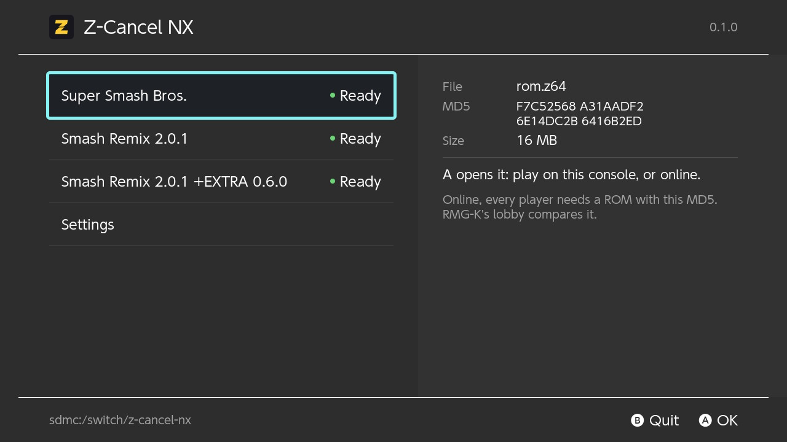
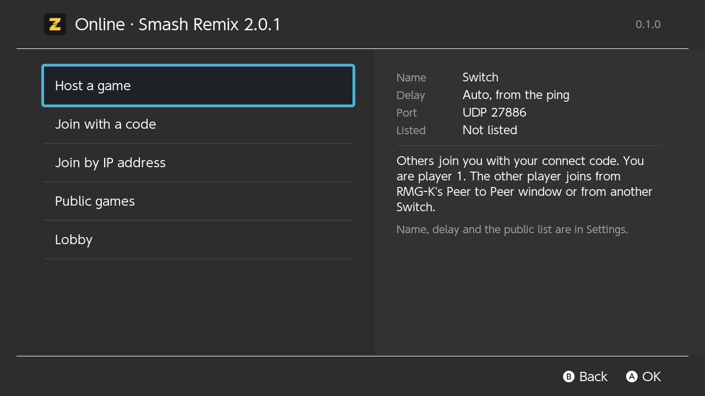
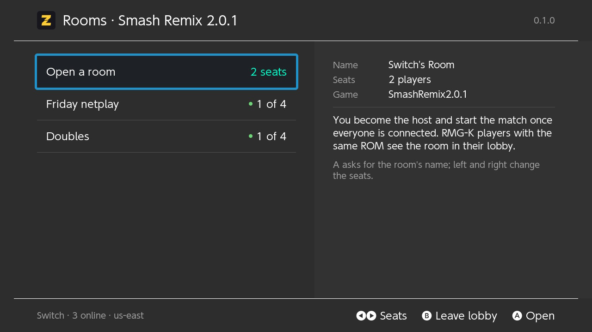
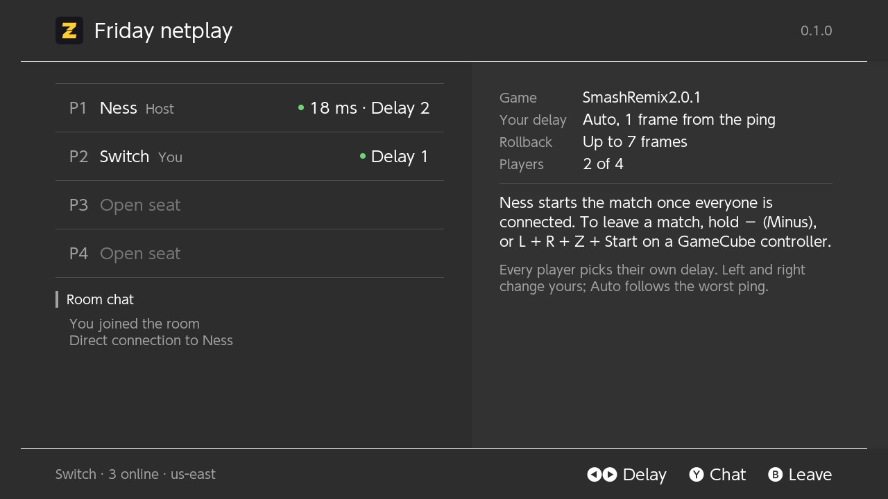

<p align="center"></p>

# Z-Cancel NX

Super Smash Bros. (N64), Smash Remix and Smash Remix +EXTRA on a Nintendo Switch, with rollback
netplay that plays against PC players on [RMG-K](https://github.com/Jay-Day/RMG-K).

You bring your own ROM. Nothing from a game is in this repository or in a release.

| | |
|---|---|
|  |  |
|  |  |

Screenshots from a Switch: the start screen, the online menu, RMG-K's lobby and a room waiting to
start. The menus follow the console's own light or dark theme.

## What you need

- A Switch running Atmosphere, with the Homebrew Menu.
- Your own dump of Super Smash Bros., USA version (`.z64`, `.n64` or `.v64`).
- For online play: the console on your network, ideally by cable.

## Install

1. Download `Z-Cancel-NX-v<version>.zip` from [Releases](../../releases) and copy its `switch`
   folder onto the root of your SD card.
2. Copy your Super Smash Bros. ROM into `switch/z-cancel-nx/`. The name does not matter.
3. Open the Homebrew Menu by holding R while starting a game, and start Z-Cancel NX. The Album
   shortcut does not give homebrew enough memory.

## Pick a game

The start screen offers three games, so you can always match what the other player runs:

| Game | Where it comes from |
|---|---|
| Super Smash Bros. | Your ROM |
| Smash Remix 2.0.1 | Built on the console from your ROM and the official patch |
| Smash Remix 2.0.1 +EXTRA 0.6.0 | Built on the console from your ROM and the official patch |

The first time you choose a Remix game the app downloads the patch from the project's GitHub
release, applies it and checks the result against the checksum RMG-K expects. Without internet,
put the `.xdelta` file in `switch/z-cancel-nx/patches/` yourself.

## Controls

| Switch | GameCube controller | N64 |
|---|---|---|
| A, B | A, B | A, B |
| ZL, ZR | L, R | Z (shield) |
| R | Z | R (grab) |
| L | | L (taunt) |
| X, Y, right stick | X, Y, C-stick | C buttons |
| Plus | Start | Start |
| Left stick | Control stick | Control stick |

Leave a game by holding Minus, or L + R + Z + Start on a GameCube controller, for half a second.

In Settings on the start screen:
- **L button**: taunt (default) or shield. Smash Remix can put taunt on the d-pad (Dpad ctrl on the
  character screen).
- **C stick**: the N64's C buttons (default), or smash attacks on the ground and aerials in the air,
  as in Melee, on GameCube controllers or on every controller.
- Stick range and sound.

These change only your own controller, never the game, so they are safe online.

## Online

Choose a game, then Online. Both players need the same game.

| Option | What it does |
|---|---|
| Host a game | Shows a connect code (or your address) to give to the other player |
| Join with a code | Type the host's code |
| Join by IP address | Type the host's address and port |
| Public games | Games hosted on the public list |
| Lobby | RMG-K's lobby, for rooms of up to four players. A room can have a password, which the host gives out |

A PC player on RMG-K v0.9.16 joins the same way from its Peer to Peer or lobby window. Lobby rooms
have no codes of their own: to play one particular person, use Host a game and give them the
connect code, or open a lobby room with a password.

## Status

Tested on an Erista (first model) Switch:

- All three games play with picture, sound and controllers. Every stage of all three was run with
  four level 9 CPUs: no frame of game work over 16.7 ms once each shader has been built (the app
  ships the shader list, so that happens at start).
- Rollback: rewinding and re-running gives the identical state every time, in all three games. A
  rollback of up to five frames fits inside one frame; a full seven-frame rollback (about 120 ms of
  lag) can make one frame late.
- The Switch produces the same emulated state as a Mac running the same core, checked every 600
  frames through full matches, also with added lag and packet loss.
- Online: hosting and joining by address and through the lobby against a Mac build of the same code,
  on a local network and through the public internet path (a 60-second lobby match with no stalls).

Known issues:
- With vsync, a few moments in some matches show one frame about 10 ms late (the graphics driver
  waits); never two frames.
- Not yet tested in a match against RMG-K on a Windows PC, or through the community's connect-code,
  public-list and lobby servers. Reports are welcome.

Frame-time measurements for every stage are in [docs/STAGE_MATRIX.md](docs/STAGE_MATRIX.md).

## Build from source

Needs Docker, git and Python 3 on macOS or Linux.

```bash
builder/fetch-deps.sh       # RMG-K and xdelta3 at the pinned commits, into ref/
builder/docker-image.sh     # the devkitA64 toolchain image, once
builder/build-switch.sh     # build/switch/z-cancel-nx.nro
```

`tools/release.sh` packages a release zip. How the port works, what was learned from RMG-K's
source and the test results are in [docs/PLAN.md](docs/PLAN.md).

## Licence and credits

Z-Cancel NX is a port of [RMG-K](https://github.com/Jay-Day/RMG-K) (Rosalie's Mupen GUI with
Kaillera and GekkoNet rollback) and of mupen64plus, with GLideN64 for the picture. It is licensed
under the GNU General Public License v3.0; see [LICENSE](LICENSE) and
[THIRD_PARTY_NOTICES.md](THIRD_PARTY_NOTICES.md).

It is not affiliated with Nintendo, the RMG-K authors or the Smash Remix team.
